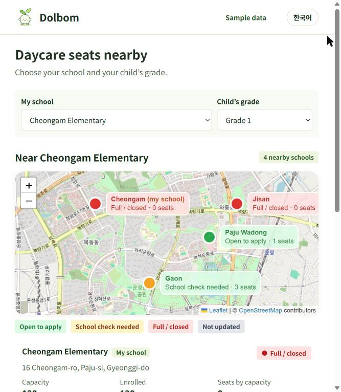
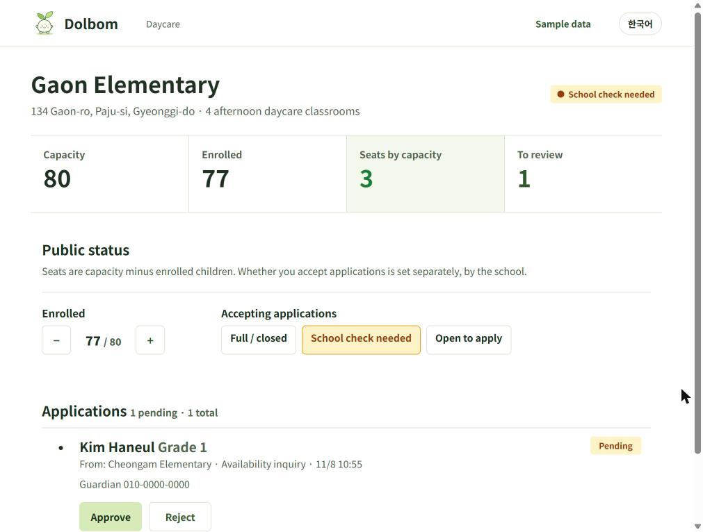
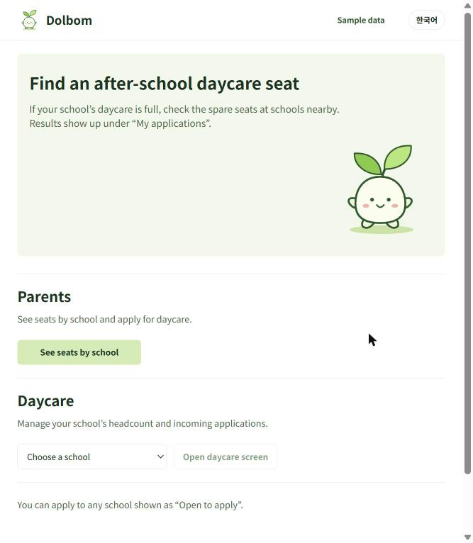

# 돌봄빈자리 (Dolbom Binjari) — spare after-school care seats, shared between neighbouring schools

> **Sample data.** Every headcount, status and application in this demo is invented. School names, addresses and classroom counts are public data; nothing else is real. See [Data](#data-and-sources).

**Built during HackCamp 2026 with an AI coding agent (Claude Code).**

| Parent (phone) | Teacher (PC / tablet) | Home |
|---|---|---|
|  |  |  |

## The problem

Korean public elementary schools run after-school care classrooms (초등돌봄교실). A family can only apply to **their own school**, once a year. If care becomes necessary mid-year — a parent changes jobs, a grandparent falls ill — and the home school is full, the child has nowhere to go, even when a school ten minutes away has empty seats. Nobody can see those seats, and no process lets the family use them.

In 2022 there were 3,786 children on after-school care waiting lists in Gyeonggi province alone, 15,108 nationwide (Ministry of Education data reported by Newsis, 2022-09-27).

## The idea

Do not build new facilities. **Connect the seats that already exist.**

1. Group 4–5 nearby schools into a **bundle** (묶음).
2. Show every school in the bundle on one map with its live care status.
3. Let a parent apply only to schools **inside their bundle**.
4. The receiving school's daycare (돌봄교실) staff check the school's own rules and **approve or reject with a reason**.

One principle runs through the whole app:

> **"Seats by capacity" and "accepting applications" are different things.**
> Seats by capacity (`capacity − current`) is computed automatically. Whether a school accepts outside children is decided by the school. A school with 3 empty seats still shows **"학교 확인 필요 / School check needed"** until the school switches itself to "open".

### Marker rules (applied top to bottom)

| # | Condition | Marker | Label | Parent button |
|---|---|---|---|---|
| 1 | `updatedAt` older than 24 h | grey | 정보 갱신 안 됨 / Not updated | none |
| 2 | seats = 0 **or** status `closed` | red | 마감 / Full · closed | 대기 안내 (waitlist info, home school only) |
| 3 | status `check` | yellow | 학교 확인 필요 / School check needed | 이용 가능 여부 문의 (ask about availability) |
| 4 | status `open` | green | 신청 가능 / Open to apply | 신청하기 (apply) |

Colour is never the only cue: the label text is always shown next to the marker and on every card.

### Languages

The UI is **English by default** with a **한국어** toggle in the header (the choice is kept in the browser). Every screen, marker label, button and error is translated; school names switch between the Korean and English forms. Server error messages are Korean and are mapped to English on the client by error code (`web/src/lib/i18n.ts`).

## Run it (Windows PowerShell)

Requirements: Node.js 20 or newer, npm.

```powershell
cd app
npm.cmd install
npm.cmd run dev
```

- Web: <http://localhost:5173> (Vite, started with `--host` so phones on the same Wi-Fi can open it)
- API + Socket.IO: <http://localhost:3001> (proxied by Vite, so phones only need the Vite URL)

Open on phones:

```powershell
ipconfig            # find your IPv4 address, e.g. 192.168.0.12
# phone 1 (parent):  http://192.168.0.12:5173/parent
# phone 2 (teacher): http://192.168.0.12:5173/teacher/gaon
```

Other commands:

```powershell
npm.cmd test        # Vitest: rules + API (supertest)
npm.cmd run lint    # ESLint
npm.cmd run build   # type-check + Vite production build (web/dist)
npm.cmd start       # serve API + built web from one port (3001)
```

Reset the demo at any time with **"데이터 초기화"** at the bottom of the home screen (`POST /api/reset`). It rewrites `server/data/db.json` from the seed and clears this device's "my applications".

### Routes (no login — roles are URLs)

| URL | Who | What |
|---|---|---|
| `/` | everyone | pitch, entry points, data reset |
| `/parent` | parent on a phone | choose home school + grade → bundle map and cards → detail sheet → apply / inquire → "내 신청" live status |
| `/teacher/:schoolId` | school daycare (돌봄교실) | capacity / current / seats / pending counters, current −/+, 3-way accepting status, approve / reject with reason |

Every change is broadcast over Socket.IO, so a decision on the teacher's screen appears on the parent's phone immediately.

## Structure

```
app/
├─ package.json          one package: scripts for dev / build / test / lint
├─ shared/
│  ├─ types.ts           School, Bundle, Application, Db
│  ├─ rules.ts           pure rules: vacancy, markerState, schoolsInBundle,
│  │                     validateNewApplication, approve, reject, updateSchool
│  ├─ rules.test.ts      29 tests for the rules
│  └─ seed.ts            sample data (see below)
├─ server/
│  ├─ index.ts           http + Socket.IO + static web/dist
│  ├─ app.ts             Express routes (all state changes go through shared/rules)
│  ├─ app.test.ts        19 supertest API tests
│  ├─ store.ts           JSON file store (server/data/db.json)
│  └─ data/db.json       runtime state (gitignored, regenerated from seed)
└─ web/                  React + Vite + TypeScript, mobile first
   ├─ src/pages/         HomePage, ParentPage, TeacherPage
   ├─ src/components/    SchoolMap (react-leaflet + OSM tiles), SchoolCard,
   │                     SchoolDetail, ApplyForm, MyApplications, ApplicationRow, StatusBadge
   └─ src/lib/           api.ts (fetch), live.ts (Socket.IO refetch hook), storage.ts,
                         i18n.ts (EN/KO strings) + LangContext.tsx (language toggle)
```

### API

| Method | Path | Purpose |
|---|---|---|
| GET | `/api/schools` | all schools |
| GET | `/api/bundle?schoolId=` | schools in the same bundle as `schoolId` |
| GET | `/api/schools/:id/applications` | applications received by a school |
| PATCH | `/api/schools/:id` | `{ current?, status? }` (teacher), refreshes `updatedAt` |
| GET | `/api/applications?ids=a,b` | a parent's own applications (ids kept in the phone's localStorage) |
| POST | `/api/applications` | create; refused if outside bundle, school not accepting, duplicate, or invalid |
| POST | `/api/applications/:id/approve` | current + 1 (409 when full) |
| POST | `/api/applications/:id/reject` | `{ reason }` required |
| POST | `/api/reset` | restore seed |

Events: `schools:changed`, `applications:changed`, `db:reset`.

## Data and sources

- **Public:** school names, addresses and the number of afternoon-care classrooms come from the Gyeonggi Provincial Office of Education, *2026 온동네 돌봄·교육 자원지도* (Paju edition). Capacity is assumed as classrooms × 20.
- **Invented for the demo:** current headcounts, accepting statuses, every application, every name (e.g. 김하늘) and phone number (010-0000-0000). No real child or guardian data exists anywhere in this repository.
- **Coordinates:** OpenStreetMap Nominatim. 파주와동초등학교 is listed in OSM as "와동초등학교" (37.726425, 126.7570207), about 150 m from its road address — the one coordinate still to be confirmed by a human; edit `shared/seed.ts` and press "데이터 초기화" to change it.
- Map tiles: © OpenStreetMap contributors. No API keys are used.

Two bundles are seeded: **운정 가까운 학교 묶음** (청암초 full, 가온초 check, 파주와동초 open, 지산초 full) and **문산 묶음** (문산초 open). A 운정 parent never sees 문산초 — that is the bundle filter at work.

## Limitations (what a real deployment would need)

This is a hackathon demo. Deliberately missing:

- **No login.** Roles are URLs. A real system needs administrator authentication, per-school permissions for daycare staff, and guardian identity verification.
- **No policy engine.** Each school's rules (residency, grade limits, sibling priority, fees) are checked by the daycare staff by hand. Encoding them would come later, with the education office.
- **Transport safety** between the home school and the host school (who walks the child, insurance, pickup) is out of scope here and is the first thing to design with schools.
- **Storage** is a JSON file; fine for a demo, not for production.
- **Bundles are hand-picked** in the seed. A real pilot would define them with the regional education office (교육지원청).

## Tests

```
Test Files  4 passed (4)
     Tests  57 passed (57)
```

- `shared/rules.test.ts` — marker priority, bundle filter, approve/reject, duplicate and out-of-bundle refusal, immutability
- `shared/seed.test.ts` — capacity = classrooms × 20, timestamps, fake-only contact data
- `server/app.test.ts` — every route, error codes, broadcast events
- `web/src/lib/i18n.test.ts` — English default, EN/KO key parity, daycare wording, error-code mapping

Map data © OpenStreetMap contributors (ODbL).
